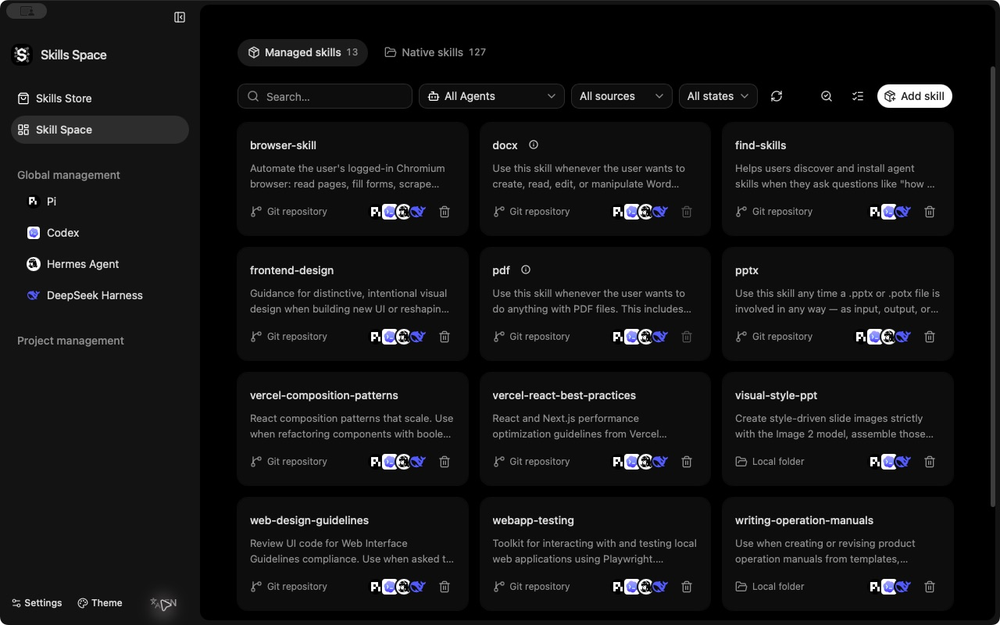

<h1 align="center">
   Skills Space
</h1>

<p align="center"><strong>Discover, install, and manage skills across your AI agents.</strong></p>

<p align="center">
  <strong>English</strong> · <a href="./README.zh-CN.md">简体中文</a>
</p>

<p align="center">
  <a href="#features">Features</a> ·
  <a href="#agent-integrations">Agent integrations</a> ·
  <a href="#quick-start">Quick start</a> ·
  <a href="#development">Development</a>
</p>

<p align="center">
  
</p>

Skills Space is a desktop application for managing skills across Codex, Claude Code, Pi, Hermes, DeepSeek Harness, and other AI agents. It combines skill discovery, installation, and maintenance across global and project scopes.

## Features

| Feature | What you can do |
| --- | --- |
| **Unified management** | Manage CLI-managed and native skills across agents, with global/project scopes, sources, and installation status. |
| **Skill store** | Browse leaderboards, search skills, and read full documents, installation instructions, and repository details without cloning. |
| **Installation and sharing** | Install from Git repositories, local directories, or supported download URLs; share skills with selected agents and projects. |
| **Native skill controls** | Preserve existing directories and control enable/disable, automatic selection, manual invocation, and preloading where supported. |
| **Updates and maintenance** | Check updates and local differences, review shared removal impact, run batch actions, and install from project dependencies or supported lockfile entries. |
| **Configuration and extensions** | Manage skill directories, agent settings, DSH presets, Codex plugins, and Pi extension packages. |

Installation, updates, and removal use a pinned, unmodified [Vercel skills CLI](https://github.com/vercel-labs/skills), without a separate fork.

## Agent integrations

**General support** follows the agent definitions in the bundled skills CLI for installation and maintenance. **Enhanced integration** adds agent-specific management:

| Agent | Additional capabilities |
| --- | --- |
| Codex | Native skill controls, local plugins and marketplaces, and supported global/project settings. |
| Pi | Skill directories, enable/disable and invocation controls, code mode settings, and extension packages. |
| Hermes | Skill directories, project discovery and trust, enable/disable, and preload settings. |
| DeepSeek Harness (DSH) | Configuration-file and preset discovery, skill directories, and independent enable/disable and invocation policies. |

DSH's independent policies require the companion plugin installed through Skills Space. They preserve skill files; the policy is shared wherever the same physical skill file is used. See the [DSH guide](./docs/specs/0012-dsh-settings-native-skills-rebuild.md) for scope and activation details.

> [!NOTE]
> Available actions depend on the skill's source, ownership, agent, and scope. A skill found on disk is not proof that a running agent has loaded it. Current verification primarily covers macOS arm64; other platforms and remaining scenarios are tracked in the [roadmap](./docs/specs/0004-upstream-capability-completion-plan.md).

## Quick start

### Source setup

Install Node.js **22.20.0 or later**, **pnpm 11.5.0** (the repository-pinned version), Rust, and the [Tauri 2 prerequisites](https://v2.tauri.app/start/prerequisites/) for your platform. Git is needed to clone the repository and work with Git sources.

```bash
git clone https://github.com/arch3rPro/Skills-Space.git
cd Skills-Space
pnpm install --frozen-lockfile
CI=false pnpm tauri dev
```

The commands above use a POSIX shell. `tauri dev` prepares the bundled CLI and starts both the frontend and desktop app.

### Usage

1. Choose **Global** or add and select a project.
2. Open **Skill store** to browse or search, or choose **Install skills** to enter a source.
3. Inspect the source, select skills and target agents, and review the installation settings.
4. Confirm, then inspect the results in your skill collection or the agent's page.

For a packaged app, Node is detected automatically. You can select an executable in **Settings → Global**. If no compatible runtime is available, the app downloads a pinned official Node into its application data directory; it does not replace your system Node or installed commands.

## Development

The app uses **React 19, TypeScript, Vite, Tauri 2, and Rust**. Presentation lives in `src/`; filesystem, process, and native capabilities live in `src-tauri/`.

<details>
<summary>Checks and build commands</summary>

Run frontend checks and prepare the CLI resources before native tests:

```bash
pnpm test:frontend-contracts
pnpm build
pnpm test:native
```

Build a debug macOS application bundle:

```bash
CI=false pnpm tauri build --debug --bundles app
```

Resource staging and native tests must run sequentially. See the [development guide](./docs/agents/development.md) for platform setup, isolated test fixtures, verification scope, and packaging details.

</details>

## Documentation

- [Capability map](./docs/research/upstream-command-map.md) — supported commands, sources, and integration boundaries.
- [Roadmap](./docs/specs/0004-upstream-capability-completion-plan.md) — completed work, remaining development, and verification gaps.
- [Architecture decision](./docs/adr/0005-use-unmodified-upstream-cli.md) — why lifecycle operations use the unmodified upstream CLI.
- [Documentation index](./docs/README.md) — specifications, agent guides, design, research, and historical records.
