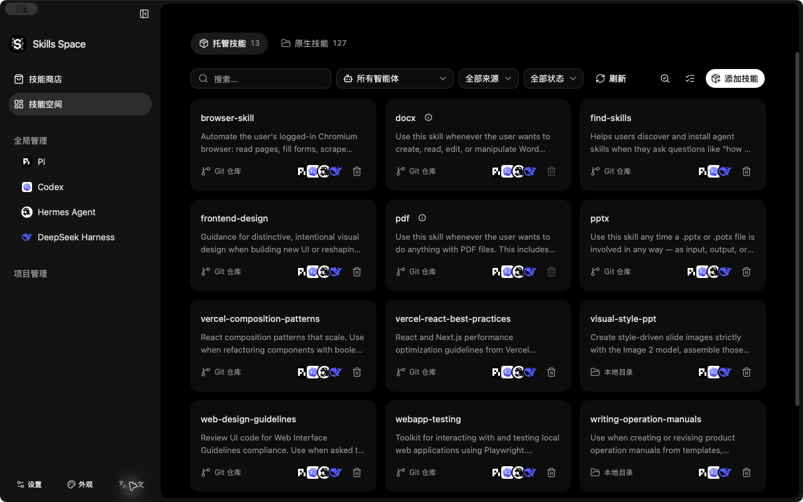

<h1 align="center">
   Skills Space
</h1>

<p align="center"><strong>集中发现、安装和管理不同 AI Agent 的技能。</strong></p>

<p align="center">
  <a href="./README.md">English</a> · <strong>简体中文</strong>
</p>

<p align="center">
  <a href="#主要功能">主要功能</a> ·
  <a href="#agent-适配">Agent 适配</a> ·
  <a href="#快速开始">快速开始</a> ·
  <a href="#开发">开发</a>
</p>

<p align="center">
  
</p>

Skills Space 是一款跨 Agent 的桌面技能管理工具，面向 Codex、Claude Code、Pi、Hermes、DeepSeek Harness 等 AI Agent，集中提供技能发现、安装及全局／项目范围的维护能力。

## 主要功能

| 功能 | 说明 |
| --- | --- |
| **统一管理** | 集中管理多个 Agent 的托管与原生技能，区分全局和项目范围，查看来源与安装状态。 |
| **技能商店** | 浏览榜单、搜索技能，查看完整正文、安装说明及仓库信息；浏览无需克隆。 |
| **安装与共享** | 支持 Git 仓库、本地目录和下载链接，将技能安装或共享到指定 Agent 与项目。 |
| **原生技能控制** | 保留已有技能目录，按 Agent 能力控制启用／停用、自动选择、手动调用与预加载。 |
| **更新与维护** | 检查更新和本地差异，核对共享卸载影响，支持批量处理、项目依赖安装与锁文件恢复。 |
| **配置与扩展** | 管理技能目录、Agent 设置与 DSH 预设，以及 Codex 插件和 Pi 扩展包。 |

安装、更新和卸载复用固定版本的原版 [Vercel skills CLI](https://github.com/vercel-labs/skills)，不维护独立分叉。

## Agent 适配

**通用支持**按照随应用固定的 skills CLI 的 Agent 定义提供技能安装与维护。**增强适配**进一步提供各 Agent 的专属管理能力：

| Agent | 增强能力 |
| --- | --- |
| Codex | 原生技能控制、本地插件与市场，以及支持的全局／项目设置。 |
| Pi | 技能目录、启用／停用与调用控制、代码模式设置、扩展包管理。 |
| Hermes | 技能目录、项目发现与信任、启用／停用、预加载设置。 |
| DeepSeek Harness（DSH） | 配置文件与预设发现、技能目录、独立启停与调用策略。 |

DSH 的独立策略需要通过 Skills Space 安装配套插件，不修改技能文件；使用同一实际技能文件的位置会共享该文件的策略。作用范围与生效方式见 [DSH 说明](./docs/specs/0012-dsh-settings-native-skills-rebuild.md)。

> [!NOTE]
> 可用操作取决于技能来源、归属、Agent 和范围。发现磁盘上的技能不代表正在运行的 Agent 已加载它。当前主要验证 macOS arm64，其他平台及尚待验证的场景见[后续计划](./docs/specs/0004-upstream-capability-completion-plan.md)。

## 快速开始

### 源码运行

准备 **Node.js 22.20.0 或更新版本**、仓库固定的 **pnpm 11.5.0**、Rust，以及对应平台的 [Tauri 2 开发依赖](https://v2.tauri.app/start/prerequisites/)。克隆项目和使用 Git 来源还需要安装 Git。

```bash
git clone https://github.com/arch3rPro/Skills-Space.git
cd Skills-Space
pnpm install --frozen-lockfile
CI=false pnpm tauri dev
```

上述命令使用 POSIX shell。`tauri dev` 会准备随包 CLI，并启动前端和桌面应用。

### 使用流程

1. 选择「全局」，或添加并选择一个项目。
2. 打开「技能商店」浏览或搜索，也可点击「安装技能」输入来源。
3. 检查来源，选择技能与目标 Agent，核对安装设置。
4. 确认安装，在技能空间或对应 Agent 页面查看结果。

打包后的应用会自动检测 Node，也可在「设置 → 全局」选择可执行文件。缺少兼容运行时，应用会将固定版本的官方 Node 下载到应用数据目录，不替换系统 Node 或已安装命令。

## 开发

项目使用 **React 19、TypeScript、Vite、Tauri 2 和 Rust**。界面位于 `src/`，文件系统、进程及原生能力位于 `src-tauri/`。

<details>
<summary>检查与构建命令</summary>

先运行前端检查并准备 CLI 资源，再执行原生测试：

```bash
pnpm test:frontend-contracts
pnpm build
pnpm test:native
```

构建 macOS 调试应用包：

```bash
CI=false pnpm tauri build --debug --bundles app
```

资源准备与原生测试应顺序执行。平台依赖、隔离测试数据、验证范围和打包说明见[开发指南](./docs/agents/development.md)。

</details>

## 项目文档

- [能力与接入状态](./docs/research/upstream-command-map.md) — 支持的命令、来源与适配范围。
- [后续计划](./docs/specs/0004-upstream-capability-completion-plan.md) — 已完成、待开发及待验证事项。
- [架构决策](./docs/adr/0005-use-unmodified-upstream-cli.md) — 技能生命周期复用原版 CLI 的原因。
- [文档索引](./docs/README.md) — 规范、Agent 说明、设计、调研和历史记录。
